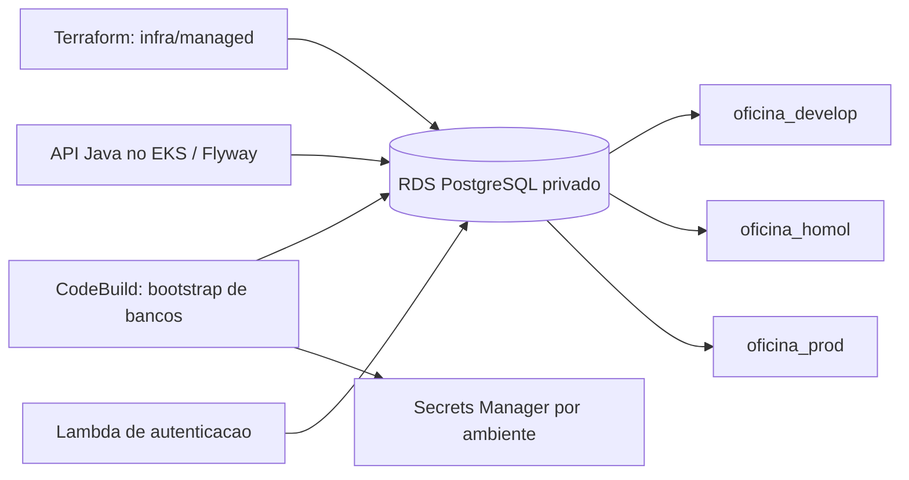

# fiap-database

Infraestrutura do PostgreSQL privado no Amazon RDS e bootstrap de bancos, usuários e segredos por ambiente. O RDS atende à aplicação e à autenticação; as tabelas são gerenciadas pelo Flyway do `fiap-application`.

📚 **[Documentação principal — fiap-docs](https://github.com/FIAP-GRUPO05/fiap-docs)**

## Tecnologias e requisitos

Terraform 1.13+, Python 3.12, PostgreSQL/RDS, Secrets Manager e CodeBuild. AWS CLI autenticado é necessário para bootstrap administrativo. Os testes locais de scripts não exigem conta AWS.

## Arquitetura deste componente



## Validar localmente

Na raiz deste repositório:

```powershell
terraform -chdir=infra/managed fmt -check
terraform -chdir=infra/managed init -backend=false -input=false
terraform -chdir=infra/managed validate
python -m unittest discover -s .github/scripts -p 'test_*.py' -v
```

Esses comandos validam código, sem criar RDS. Para desenvolvimento com banco local, execute o Compose do [fiap-application](https://github.com/FIAP-GRUPO05/fiap-application).

## Deploy e ambientes

O fluxo é `feature/* → develop → release/vX.Y.Z → prod → main`. Após o push da feature e o sucesso da CI, o PR é aberto automaticamente; os merges são manuais. Os próximos PRs são gerados após a promoção aprovada. `develop`, `release/*` e `prod` publicam no ambiente correspondente quando a infraestrutura está `active`; `prod → main` apenas consolida a versão.

Em `destroyed`/`destroying`, deploys e promoções ficam bloqueados. Em `maintenance`, a CI permite validar e promover código, mantendo os deploys bloqueados. O bootstrap administrativo usa AWS CLI; a operação diária do CI usa OIDC e não exige credenciais AWS de cada integrante.

A raiz ativa é `infra/managed`; `infra/prod` pertence ao laboratório anterior. O primeiro provisionamento depende da plataforma do `fiap-k8s`. Na publicação de `prod`, a CI aplica o Terraform e inicia o bootstrap privado; nos ambientes, acompanha o CodeBuild e valida conexão TLS. O bootstrap é executado novamente após as primeiras migrations para criar os administradores. Após reconstrução do RDS, atualiza o host dos segredos restaurados, preservando usuário e senha.

A instância é compartilhada para reduzir custos, com bancos, usuários e segredos distintos. Backups e proteção contra exclusão são configurados no Terraform. A desmontagem segue o pedido protegido `feature/destroy-infra-aws` do `fiap-k8s`, com aprovação e relatório.

## Contratos e disponibilidade

O banco não expõe API HTTP própria nem Swagger. O contrato relacional está no [DER e justificativa](https://github.com/FIAP-GRUPO05/fiap-docs/tree/main/database); o [Swagger da aplicação](https://github.com/FIAP-GRUPO05/fiap-application#api-e-urls-dos-ambientes) descreve as APIs consumidoras. O RDS foi desmontado para controle de custos; seu endpoint privado é obtido pelos outputs Terraform após reconstrução, nunca publicado como URL pública.

## Membros da equipe

<table>
  <tr>
    <td align="center" width="160">
      <a href="https://www.linkedin.com/in/wesslima/" title="Wesley Lima">
        <br>
        <sub><b>Wesley Lima</b></sub>
      </a><br><sub>Backend Engineer</sub>
    </td>
    <td align="center" width="160">
      <a href="https://www.linkedin.com/in/tim-morgenstern-4581911b1/" title="Tim Morgenstern">
        <br>
        <sub><b>Tim Morgenstern</b></sub>
      </a><br><sub>Backend Engineer</sub>
    </td>
    <td align="center" width="160">
      <a href="https://www.linkedin.com/in/matheus-pitas-baptista/" title="Matheus Pitas Baptista">
        <br>
        <sub><b>Matheus Pitas Baptista</b></sub>
      </a><br><sub>Backend Engineer</sub>
    </td>
  </tr>
</table>
