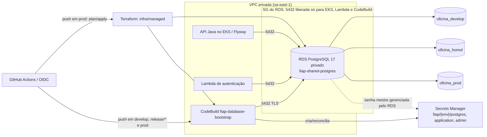

# fiap-database

Infraestrutura do PostgreSQL privado no Amazon RDS e bootstrap de bancos, usuários e segredos por ambiente. O RDS atende à aplicação e à autenticação; as tabelas são gerenciadas pelo Flyway do `fiap-application`.

📚 **[Documentação principal — fiap-docs](https://github.com/FIAP-GRUPO05/fiap-docs)**

## Tecnologias e requisitos

Terraform 1.13+, Python 3.12, PostgreSQL 17/RDS, Secrets Manager e CodeBuild. AWS CLI autenticado é necessário para bootstrap administrativo. Os testes locais de scripts não exigem conta AWS.

## Arquitetura deste componente

Há uma única instância RDS compartilhada, com bancos lógicos, usuários e segredos separados por ambiente, por decisão de custo ([justificativa](https://github.com/FIAP-GRUPO05/fiap-docs/blob/main/database/justificativa-formal-postgres.md); [modelo de dados](https://github.com/FIAP-GRUPO05/fiap-docs/blob/main/database/README.md)).



Fonte editável: [`docs/arquitetura.mmd`](docs/arquitetura.mmd).

> ⚠️ **Legado:** `infra/prod/` e `k8s/` pertencem ao laboratório anterior (PostgreSQL em pod no Kubernetes, `us-east-1`). Não são usados pelo pipeline e **não devem ser aplicados**. A raiz ativa é `infra/managed`.

## Validar localmente

Na raiz deste repositório:

```bash
terraform -chdir=infra/managed fmt -check
terraform -chdir=infra/managed init -backend=false -input=false
terraform -chdir=infra/managed validate
python -m unittest discover -s .github/scripts -p 'test_*.py' -v
```

Esses comandos validam código, sem criar RDS. Para desenvolvimento com banco local, execute o Compose do [fiap-application](https://github.com/FIAP-GRUPO05/fiap-application).

## Deploy e ambientes

O fluxo é `feature/* → develop → release/vX.Y.Z → prod → main`. Após o push da feature e o sucesso da CI, o PR é aberto automaticamente; os merges são manuais. Os próximos PRs são gerados após a promoção aprovada.

O `terraform apply` da instância RDS compartilhada roda **somente no push em `prod`**. Em `develop` e `release/*`, o job de deploy apenas inicia, por OIDC, o CodeBuild `fiap-database-bootstrap` (`infra/managed/bootstrap_databases.py`), que cria ou reconcilia bancos lógicos, roles e segredos, e aguarda seu resultado:

| Branch (push) | Ambiente | Banco lógico | O que a CI executa |
|---|---|---|---|
| `develop` | develop | `oficina_develop` | Bootstrap privado (CodeBuild) |
| `release/vX.Y.Z` | homol (homologação) | `oficina_homol` | Bootstrap privado (CodeBuild) |
| `prod` | prod (produção) | `oficina_prod` | `terraform plan/apply` de `infra/managed` + bootstrap privado |
| `main` | — | — | Nada é publicado; `prod → main` apenas consolida a versão |

Cada execução do bootstrap percorre os três ambientes (`develop`, `homol`, `prod`) e é idempotente: cria apenas o que falta e preserva os segredos existentes. O nome do banco e do usuário segue `oficina_<ambiente>`.

Os deploys só rodam com a infraestrutura `active`. Em `destroyed`/`destroying`, deploys e promoções ficam bloqueados. Em `maintenance`, a CI permite validar e promover código, mantendo os deploys bloqueados. A operação diária do CI usa OIDC e não exige credenciais AWS de cada integrante; o provisionamento manual abaixo usa AWS CLI com perfil administrativo.

O primeiro provisionamento depende da plataforma do `fiap-k8s` (VPC, sub-redes privadas e security groups do EKS e da Lambda são lidos do estado remoto `fiap/platform-shared.tfstate`). O bootstrap é executado novamente após as primeiras migrations para criar os administradores. Após reconstrução do RDS, ele atualiza o host dos segredos restaurados, preservando usuário e senha.

Backups (sete dias) e proteção contra exclusão são configurados no Terraform. A desmontagem segue o pedido protegido `feature/destroy-infra-aws` do `fiap-k8s`, com aprovação e relatório.

## Provisionamento manual

Na raiz deste repositório, com AWS CLI autenticado na conta `456687462806` (`sa-east-1`):

```bash
export AWS_PROFILE=<perfil-administrador>
terraform -chdir=infra/managed init -backend-config=backend.hcl
terraform -chdir=infra/managed plan
terraform -chdir=infra/managed apply

build_id=$(aws codebuild start-build --project-name fiap-database-bootstrap --query build.id --output text)
python .github/scripts/wait_codebuild.py "$build_id"
```

O estado remoto fica em `s3://fiap-tfstate-456687462806/fiap/database-shared.tfstate` (`backend.hcl`); as variáveis vêm de `shared.auto.tfvars`. Os comandos do CodeBuild são os mesmos usados pela CI; os logs ficam em `/aws/codebuild/fiap-database-bootstrap`.

## Outputs e segredos

Outputs de `infra/managed` (`terraform -chdir=infra/managed output`):

| Output | Conteúdo |
|---|---|
| `db_address` / `db_port` | Endpoint privado da instância e porta (5432) |
| `db_name` / `db_username` | Banco inicial (`oficina_prod`) e usuário mestre (`oficina`) |
| `master_secret_arn` | ARN do segredo da senha mestre |
| `db_security_group_id` | Security group do RDS |

A senha mestre não é definida no Terraform: ela é gerada e gerenciada pelo próprio RDS (`manage_master_user_password = true`) e guardada no Secrets Manager; o bootstrap a lê pelo `master_secret_arn`. Para cada ambiente (`develop`, `homol`, `prod`), o bootstrap cria:

| Segredo | Conteúdo |
|---|---|
| `fiap/<ambiente>/postgres` | `username`, `password`, `dbname` e `host` do usuário `oficina_<ambiente>` |
| `fiap/<ambiente>/application` | `jwt_secret` da aplicação |
| `fiap/<ambiente>/admin` | `email` e `password` do administrador (criado após as migrations Flyway; no banco fica só o hash bcrypt) |

## Contratos e disponibilidade

O banco não expõe API HTTP própria nem Swagger. O contrato relacional está no [DER e justificativa](https://github.com/FIAP-GRUPO05/fiap-docs/tree/main/database); o [Swagger da aplicação](https://github.com/FIAP-GRUPO05/fiap-application#api-e-urls-dos-ambientes) descreve as APIs consumidoras. Em 28/10/2026, o RDS `fiap-shared-postgres` foi reconstruído com PostgreSQL 17.11, armazenamento criptografado e retenção de backups por sete dias. Os três ambientes passaram pelo bootstrap privado e pelos testes reais da aplicação. Seu endpoint privado é obtido pelos outputs Terraform, sem publicação como URL pública. `maintenance` bloqueia deploys da CI, mas mantém o banco ligado e sujeito a cobrança.

## Membros da equipe

<table>
  <tr>
    <td align="center" width="160">
      <a href="https://www.linkedin.com/in/wesslima/" title="Wesley Lima">
        <br>
        <sub><b>Wesley Lima</b></sub>
      </a><br><sub>Backend Engineer</sub>
    </td>
    <td align="center" width="160">
      <a href="https://www.linkedin.com/in/tim-morgenstern-4581911b1/" title="Tim Morgenstern">
        <br>
        <sub><b>Tim Morgenstern</b></sub>
      </a><br><sub>Backend Engineer</sub>
    </td>
    <td align="center" width="160">
      <a href="https://www.linkedin.com/in/matheus-pitas-baptista/" title="Matheus Pitas Baptista">
        <br>
        <sub><b>Matheus Pitas Baptista</b></sub>
      </a><br><sub>Backend Engineer</sub>
    </td>
  </tr>
</table>
